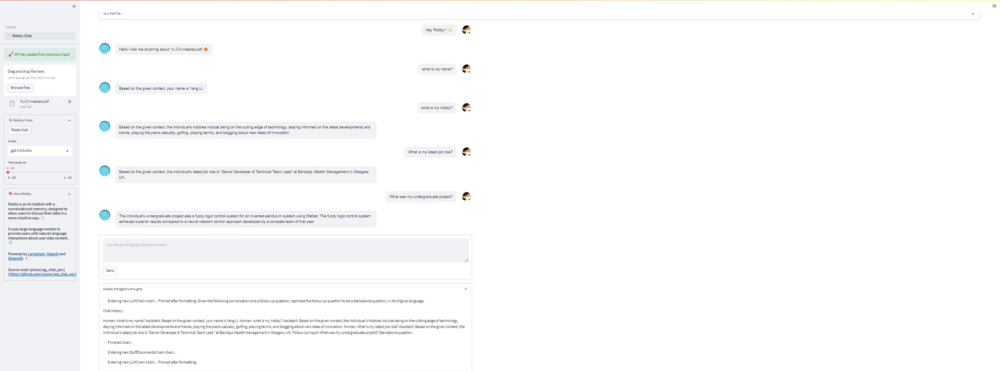

# rag_chat_poc
Experimented with Retrieval Augmented Generation based on given documents

### An AI chatbot featuring conversational memory, designed to enable users to discuss their CSV, PDF, TXT data and YTB videos in a more intuitive manner. 🚀

Robby the Robot from [Forbidden Planet](https://youtu.be/bflfQN_YsTM)

#### For better understanding, see medium article 🖖 : [Build a chat-bot over your CSV data](https://medium.com/@yvann-hub/build-a-chatbot-on-your-csv-data-with-langchain-and-openai-ed121f85f0cd)

## Running Locally 💻
Follow these steps to set up and run the service locally :

### Prerequisites
- Python 3.8 or higher
- Git

### Installation
Clone the repository :

`git clone https://github.com/yvann-hub/Robby-chatbot.git`


Navigate to the project directory :

`cd Robby-chatbot`


Create a virtual environment :
```bash
python -m venv .venv
.\.venv\Scripts\activate
```

Install the required dependencies in the virtual environment :

`pip install -r requirements.txt`


Launch the chat service locally :

`streamlit run src/Home.py`

#### That's it! The service is now up and running locally. 🤗